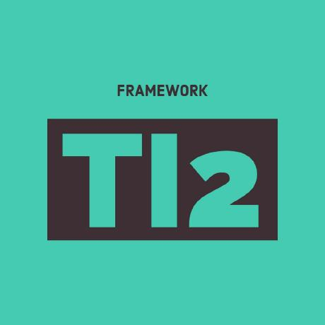
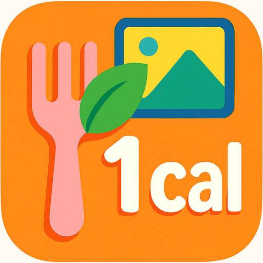

**Salvador Aceves** — software engineer (JavaScript / Python / DevOps), living nomadic 🌎. Full-time at [**TourConnect AI**](https://www.tourconnect.ai/), building production AI for travel operations.

<a href="https://www.aceves.mx/">aceves.mx</a> · <a href="https://www.linkedin.com/in/salvadoraceves/">LinkedIn</a> · <a href="https://www.instagram.com/xalakox/">Instagram</a> · <a href="https://www.youtube.com/channel/UCHh1XFiGFxLWFbQhYtivPQQ">YouTube</a> · <a href="https://twitter.com/SalvadorAceves">X</a> · <a href="https://soundcloud.com/salvadoraceves">SoundCloud</a> · <a href="https://wakatime.com/@7b655bb4-43bf-4172-af0a-1f7bdfd2c285">WakaTime</a>

> 📍 Now: booking &amp; itinerary automation at TourConnect AI · shipping privacy-first mobile apps, browser extensions &amp; AI tools on the side

## Work — TourConnect AI

AI software for DMCs and tour operators: [Itinerary Assist](https://www.tourconnect.ai/itinerary-assist), [Booking Automation](https://www.tourconnect.ai/booking-automation), [Closeouts Automation](https://www.tourconnect.ai/closeouts-automation).

<b>Day-to-day scope</b>

- Backend APIs and integrations for itinerary and booking workflows
- AWS infrastructure and Kubernetes operations for deployment, scaling, and reliability
- Python and Node.js services for automation and data processing
- Frontend product work for end-to-end delivery

More about the company: [About TourConnect AI](https://www.tourconnect.ai/about-tour-connect-ai) · [Resources](https://www.tourconnect.ai/resources)

### Open source — TI2

 [**Tourism Information Interchange**](https://github.com/ti2travel/ti2) — open framework (GPL-3.0) built under the TourConnect umbrella, standardizing bookings / content / rates exchange for the tourism industry. [Tourplan](https://github.com/TourConnect/ti2-tourplan) · [Ventrata](https://github.com/TourConnect/ti2-ventrata) · [plugins](https://github.com/ti2travel/ti2#plugins)

## Apps

Privacy-first personal Android apps — tap to expand.

 <b>Latest</b> — a podcast player that keeps one episode per show: the newest &nbsp;

- Rebuilds a single newest-first queue whenever feeds refresh — no backlog to manage
- Find shows through Apple Podcasts search or subscribe directly with a public RSS feed
- Download the newest unplayed episodes for offline listening and export feeds as OPML anytime
- Background playback with lock-screen controls, chapter-aware skipping, playback speed controls, and automatic queue handoff
- Cast to Google Cast devices and resume on your phone from the same position — no account, ads, or listener analytics

[latest.aceves.mx](https://latest.aceves.mx/) · [Google Play](https://play.google.com/store/apps/details?id=mx.aceves.latest)

 <b>PanoRibbon</b> — turn a wide photo or clip into a seamless carousel or pan video &nbsp;

- Export 2 to 10 connected carousel JPEGs (4:5, 1:1, 3:4, 9:16, or 16:9) or silent MP4 pan videos entirely on-device
- Trim and pan across source videos while they play, with custom frame order, slowdown points, loops, and black/white fades
- Reframe each slide independently with join-by-join review, resolution guidance, and Android HDR preparation
- Optional AI **Smart framing** (off by default, routed via TokenGate with zero-retention) to suggest motions and slide placement
- Share photos or videos straight into PanoRibbon — no account, no ads, and no tracking

[panoribbon.aceves.mx](https://panoribbon.aceves.mx/) · [Google Play](https://play.google.com/store/apps/details?id=mx.aceves.framefold)

 <b>Visa Logger</b> — private visa-day tracker, passport explorer &amp; travel document wallet &nbsp;

- **Visa rules engine:** Track per-visit limits, rolling-window allowances, Schengen 90/180 rules, planned trips, and residency
- **Offline Visa Explorer:** Compare visa-free, VOA, eVisa, and ETA categories across multiple passports, filter by region and stay length, and start tracking directly from results
- **Views:** Active stays overview, overlap calendar timeline, and day-by-day rolling allowance breakdown
- **Travel document wallet:** Keep passports, resident cards, visas, insurance, income proof, and trip attachments (photos, scans, PDFs) offline on your device
- **Privacy &amp; backups:** No account, ads, or server storage; encrypted local records with timestamped ZIP backups to a folder you choose and automatic retention pruning

[visa.aceves.mx](https://visa.aceves.mx/) · [Google Play](https://play.google.com/store/apps/details?id=mx.aceves.visa_logger)

 <b>Lazy Calories</b> — effortless calorie &amp; macro tracking from food photos and one quiet notification &nbsp;

- Detects food photos from your camera roll with on-device ML Kit classification, or capture meals directly with the private in-app camera
- Sends only selected food photos or short text notes through TokenGate for calorie and macro estimates, with image stacking, serving multipliers, and quick context edits
- Keeps daily calorie pace and meal tips in one quiet ongoing notification so you can glance without opening the app
- Integrates with Health Connect to add activity calories burned into your daily budget
- Meal history stays local on your phone with portable ZIP backup and restore; no account required

[lazycalories.aceves.mx](https://lazycalories.aceves.mx/) · [Google Play](https://play.google.com/store/apps/details?id=mx.aceves.lazycalcounter)

 <b>MovieShare</b> — accountless movie recommender for you and your friends, ranked on-device &nbsp;

- Rate 10 films to unlock personal recommendations ranked 100% on your phone from movies you haven't seen yet
- Connect friends via QR code or invite link to compute consensus **Group Scores** for movie night, skipping anything anyone in the group has already seen
- Send picks directly to a friend's **Inbox** with end-to-end encrypted sharing, plus optional **AI Export** ("Send to your AI Chat")
- Filter by genre, release year, origin country, and optional theatrical releases, with cast info and regional watch availability
- No accounts, ads, or tracking — ratings and rankings stay local on your phone

[movieshare.aceves.mx](https://movieshare.aceves.mx/) · [Google Play](https://play.google.com/store/apps/details?id=mx.aceves.movieshare)

 <b>SplitScreenTranslate</b> — live speech &amp; Live Transcribe translation, dual-pane &nbsp;

- Captures live microphone speech in paired source + translated panes, or mirrors and translates live text directly from **Google Live Transcribe**
- Supports on-device translation mode alongside higher-quality cloud translation
- Includes downloadable on-device speech models (Vosk / Whisper.cpp), language selection, and speaker labeling
- Runs with background service support for ongoing listening and reading sessions

## Browser Extensions

Privacy-first browser extensions — tap to expand.

 <b>Reddit News Mosaic</b> — Apple News-style story mosaic for opted-in Reddit feeds &nbsp;&nbsp;

- **Opt-in per feed:** Every feed starts as normal Reddit; flip the floating **Mosaic** pill or toolbar icon to remember your choice per feed across sorts and reloads (Home, Popular, All, News, subreddits, multi-subreddits, and custom feeds)
- **Editorial mosaic rhythm:** Flows stories into repeating 10-story blocks (Large, Feature, and Compact cards), adapting from 1 to 3 columns, a 5-column hero band on wide desktops, and dual blocks on ultrawide monitors while keeping Reddit's own top bar and left navigation intact
- **Ad-free &amp; clutter-free:** Drops promoted posts and pinned moderator announcements, with full-resolution story images, video badges, inline sort controls, and one-click comment chips
- **NSFW, spoilers &amp; theme sync:** Follows Reddit's NSFW blur preference, blurs spoilers with click-to-reveal, syncs Light/Dark/Auto themes inside an isolated Shadow DOM, and restores scroll position on Back without refetching
- **Privacy-first (Manifest V3):** Zero tracking, zero analytics, and zero third-party requests — runs strictly on `www.reddit.com` using local extension storage only

## SaaS

 <b>TokenGate</b> — the AI backend for apps &amp; SaaS: keys, prompts, plans, and quotas &nbsp;

- Keep OpenAI, Anthropic, Gemini, OpenRouter, Hugging Face, and custom-endpoint keys off devices in an AES-256-GCM envelope-encrypted organization vault
- Publish immutable prompt versions as text, vision, or image endpoints with model priority fallbacks — update prompts without shipping an app release
- Enforce monthly AI budgets per installation, plan, and prompt with Google Play subscription verification, server-side plan assignment, and Android Play Integrity checks
- Manage projects, prompts, rollouts, and usage through the web dashboard or a permission-scoped remote **Developer MCP** endpoint
- Privacy by design: routes requests without retaining payloads by default (opt-in encrypted recovery keeps responses for up to 1 hour) and tracks installations by keyed fingerprints, not user accounts

[tokengate.aceves.mx](https://tokengate.aceves.mx/) · [Trust](https://tokengate.aceves.mx/trust)

 <b>UserShaped</b> — community-driven AI product development &amp; public request boards &nbsp;

- Public product boards where members sign in with passkeys to submit feature requests, attach screenshots, and vote
- Verified app users carry extra voting weight within the apps they actively use
- Moderates submissions via TokenGate and routes approved engineering work to GitHub through a replaceable tracker adapter
- Public boards are open to browse while submission and rollout access expand during closed beta

[usershaped.aceves.mx](https://usershaped.aceves.mx/)

## Music

Guitar on [SoundCloud](https://soundcloud.com/salvadoraceves) — [My Song 8](https://soundcloud.com/salvadoraceves/my-song-8-1) · [My Song 5](https://soundcloud.com/salvadoraceves/my-song-5) · [Tart Heart](https://soundcloud.com/salvadoraceves/tart-heart-2-wav) 🎸
